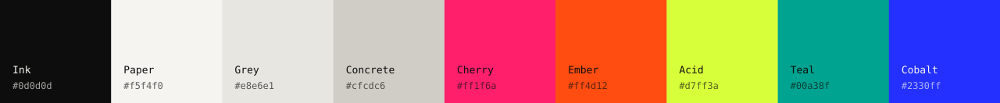

  <a href="https://iconstructa.com">website</a> ·
  <a href="https://instagram.com/iconstructa">instagram</a> ·
  <a href="https://soundcloud.com/iconstructa">soundcloud</a> ·
  <a href="https://iconstructa.bandcamp.com/">bandcamp</a> ·
  <a href="https://x.com/iconstructa">x</a> ·
  <a href="https://patreon.com/14980719/join">patreon</a>

